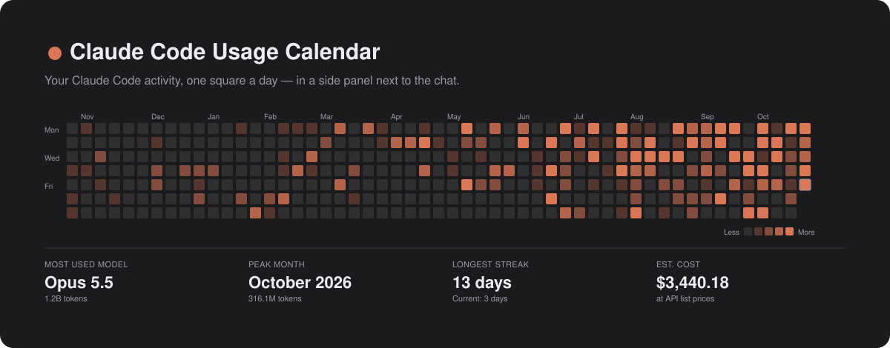
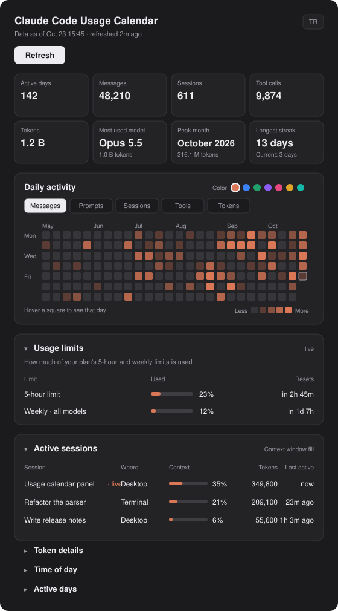
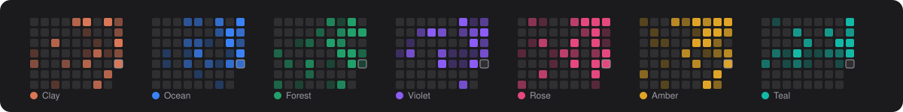

<p align="center">
  
</p>

<p align="center">
  <b>Claude Code kullanımının GitHub tarzı takvimi, sohbetin yanındaki yan panelde.</b><br>
  Günlük ısı haritası · canlı plan limitleri · oturum başına bağlam doluluğu · token ve tahmini maliyet
</p>

<p align="center">
  <a href="README.md">English</a> ·
  <a href="#kurulum">Kurulum</a> ·
  <a href="#neler-var">Neler var</a> ·
  <a href="#gizlilik">Gizlilik</a>
</p>

---

## Neler var



**Günlük aktivite ısı haritası.** Son 6 ya da 12 ay, her gün bir kare. Mesaj, istem, oturum, araç çağrısı ve token arasında geçiş yapabilirsin. Kareye gelince o günün sayısı görünür.

**Özet kutucuklar.** Aktif gün, mesaj, oturum, araç çağrısı, token, en çok kullandığın model, en yoğun ayın, en uzun ve şu anki serin.

**Canlı kullanım limitleri.** Planının 5 saatlik ve haftalık limitlerinden ne kadarının kullanıldığı ve ne zaman sıfırlanacağı. Rakamlar doğrudan Claude Code'dan gelir, sen çalıştıkça güncellenir.

**Oturum başına bağlam doluluğu.** Son 24 saatteki her oturum ve bağlam penceresinin ne kadar dolu olduğu. İçinde olduğun oturum canlı güncellenir.

**Token detayları.** Giriş, çıkış ve toplam token; aynı kullanımın API liste fiyatlarıyla tahmini maliyeti.

**Günün saatlerine göre dağılım ve gün gün tablo**, her biri açılıp kapanan bir bölümde.

**Sana göre ayarlanır.** Tek tuşla İngilizce ya da Türkçe (`TR` / `EN`), yedi vurgu rengi; panel seçtiklerini hatırlar.

<br clear="right">

<p align="center">
  
</p>

> Yukarıdaki görseller uydurma örnek verilerle çizildi.

## Kurulum

**Claude Code 2.1.308 ya da üstü** ve **Python 3** gerekir (`python3`, `python` ya da `py` komutlarından biri). Panel grafikleri Claude masaüstü uygulamasında çizer; terminalde aynı rakamları yazı olarak gösterir.

Claude Code terminal oturumunda:

```
/plugin install token-garden --marketplace Brakselk/token-garden
```

Pazar yerini eklemek için `y`, ardından bir kapsam seç (Enter kullanıcı kapsamını alır). Ya da kabuktan:

```bash
claude plugin install token-garden --marketplace Brakselk/token-garden
```

Masaüstü uygulamasında `/plugin` çalışmaz: istem kutusunun yanındaki **+**'ya, sonra **Plugins**'e tıkla; **Add marketplace** ile `Brakselk/token-garden` ekle, ardından **Add plugin**.

> Bu depo gizliyken kurulum yalnızca depoyu GitHub'da okuyabilen ve bilgisayarında github.com için git kimlik bilgisi olan kişilerde çalışır (bir SSH anahtarı ya da `gh auth login` ardından `gh auth setup-git`).

## Kullanım

- Panel her oturumda kendiliğinden açılır. × onu yalnızca o oturum için kapatır; ardından mesaj kutusunun üstünde bir **Token Garden** düğmesi çıkar ve tıklayınca yeniden açar (`/token-garden` da açar).
- **Refresh / Yenile** (panel klavyedeyken `R`) kullanımı yeniden sayar. Ayrıca oturum başında ve her 30 dakikada bir kendiliğinden yenilenir.
- **TR / EN** dili, **Renk** yanındaki noktalar vurgu rengini değiştirir; bölüm başlıkları bölümü açıp kapatır.

## Ayarlar

İkisi de isteğe bağlı ve varsayılan olarak boş. `/config` altında eklentinin satırından ya da kurulumda ayarlanır.

| Ayar | Ne yapar |
|---|---|
| `webUrl` | Panonun web sürümünün bağlantısı. Panelde **Web'de aç** bağlantısı çıkar. |
| `webRefreshTask` | O web sürümünü yenileyen Claude Code zamanlanmış görevinin adı. **Web'i de güncelle** düğmesi çıkar. |

Web sürümünün nasıl kurulacağı [docs/web-dashboard.md](docs/web-dashboard.md) dosyasında.

## Gizlilik

- Her şey senin bilgisayarında çalışır. Panel Claude Code'un `~/.claude` altındaki kendi dosyalarını (oturum dökümleri ve `stats-cache.json`) ve masaüstü uygulamasının oturum listesini okur, rakamları eklentinin yerel deposunda tutar. Hiçbir şey dışarı gönderilmez.
- Script mesajları, araç çağrılarını ve tokenları sayar, oturum başlıklarını okur. Senin ya da Claude'un yazdıklarını okumaz. Tek istisna: isteğe bağlı web yenileme görevinin kendi oturumlarını rakamlardan çıkarmak için `[token-garden-refresh]` işaretine bakar.
- Limitler ve bağlam doluluğu eklenti arayüzü üzerinden doğrudan Claude Code'dan gelir.

## Rakamlar nasıl sayılıyor

- **Mesaj**, bir oturumda senin ve Claude'un yazdığı her satırdır, araç sonuçları dahil. **İstem** yalnızca senin yazdığın mesajlardır.
- **Token**, her yanıtın girişi, önbellek yazma ve okuması ile çıkışının toplamıdır; her yanıt bir kez sayılır.
- **Tahmini maliyet** model başına API liste fiyatlarını kullanır; önbellek yazma, giriş fiyatının 1,25 (5 dakika) ya da 2 (1 saat) katıdır. Abonelik planlarında bu ayrıca ödenmez; aynı kullanımın API'de ne tutacağını gösterir.
- Claude Code eski dökümleri bir süre sonra siler. O günler için yalnızca `stats-cache.json`'daki toplamlar kalır; giriş/çıkış dağılımları genel oranlarından tahmin edilir ve panel bunu belirtir.

## Sınırlar

- Yalnızca bu bilgisayardaki Claude Code oturumları sayılır. claude.ai sohbetleri ve diğer bilgisayarlar dahil değildir.
- Panelin dayandığı eklenti arayüzü erken erişimdedir; Claude Code sürümleri arasında değişebilir.
- Fiyatlar `scripts/collect_usage.py` içinde sabittir; liste fiyatları değişince güncellenmeleri gerekir.

## Emeği geçenler

[Brakselk](https://github.com/Brakselk) tarafından, [Claude Code](https://claude.com/claude-code) ile birlikte yapıldı.

## Lisans

[MIT](LICENSE)
